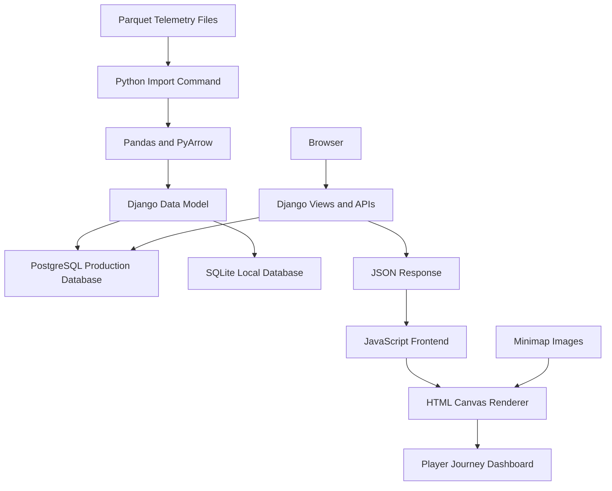

# Architecture - LILA BLACK Player Journey Visualization Tool

## 1. System Overview

The Player Journey Visualization Tool is a web-based telemetry analysis application.

It processes Parquet gameplay telemetry files, stores structured events in a relational database, and exposes filtered data through Django API endpoints.

The frontend uses JavaScript and HTML Canvas to visualize player movement and gameplay events on map minimaps.

The production application is hosted on Render and uses PostgreSQL.

---

## 2. High-Level Architecture



The import command reads the supplied Parquet files and converts their contents into structured database records.

The Django backend handles filtering and data retrieval.

The frontend renders the returned telemetry over the corresponding minimap.

---

## 3. Backend

### Framework

Django is used as the primary backend framework.

Responsibilities:

- Application routing
- Database models
- Data import management command
- Filtering and querying telemetry
- API responses
- Serving dashboard templates and static files

### Data Model

The `TelemetryEvent` model stores individual telemetry events.

Important fields:

| Field | Purpose |
|---|---|
| user_id | Identifies the player or bot |
| match_id | Identifies the match |
| map_id | Identifies the map |
| event_type | Type of gameplay event |
| x | World X coordinate |
| z | World Z coordinate |
| timestamp_ms | Match-relative event timestamp |
| is_bot | Identifies bot entities |
| date | Collection date |

Database indexes support common filtering and querying operations.

---

## 4. Data Ingestion Pipeline

The original dataset contains Parquet files organized by collection date.

The import process is implemented as a Django management command:

```bash
python manage.py load_telemetry
```

### Processing steps

1. Locate the supplied dataset directory.
2. Discover Parquet files across the date folders.
3. Read Parquet data using Pandas and PyArrow.
4. Decode event payloads.
5. Extract event types and telemetry fields.
6. Identify human players and bots.
7. Convert records into database objects.
8. Insert records in batches.

### Import result

The completed import processed:

| Metric | Result |
|---|---:|
| Files processed | 1,243 |
| Files skipped | 0 |
| Events inserted | 89,104 |

The import is performed locally using the supplied dataset, with the database connection configured to target the appropriate environment.

---

## 5. Database Architecture

The application supports two database environments.

### Local Development

SQLite is used for local development.

It allows developers to run the application without provisioning an external database.

### Production

PostgreSQL is used for the deployed Render application.

The production database connection is supplied through:

```text
DATABASE_URL
```

Database credentials are stored in Render environment variables and are not committed to source control.

---

## 6. API Layer

The Django backend provides JSON endpoints for the frontend.

### Filter Endpoint

```text
/api/filters/
```

Provides available filtering options, including maps, dates and matches.

### Telemetry Endpoint

```text
/api/telemetry/
```

Returns telemetry records and summary statistics based on the selected filters.

Supported filtering dimensions include:

- Map
- Date
- Match
- Human player visibility
- Bot visibility

The endpoint returns event information including player identity, match identity, event type, coordinates, timestamp and bot classification.

### Response Size Management

The telemetry endpoint applies a maximum of 60,000 returned rows per request.

Summary statistics are calculated separately using database queries over the complete filtered queryset.

This avoids requiring the browser to receive every matching database row in one response.

---

## 7. Frontend Architecture

The frontend is implemented using Django templates, CSS and vanilla JavaScript.

### Dashboard

The dashboard provides:

- Map selection
- Date selection
- Match selection
- Entity visibility controls
- Visualization mode selection
- Summary statistics
- Timeline controls

### Canvas Renderer

HTML Canvas is used to draw telemetry over the minimap.

Responsibilities include:

- Rendering player movement paths
- Distinguishing human and bot paths
- Rendering event markers
- Rendering kill and death zones
- Rendering traffic heatmaps
- Updating the visualization during playback

### Minimap Assets

The application includes the three supplied map images:

- Ambrose Valley
- GrandRift
- Lockdown

---

## 8. Coordinate Transformation

The source telemetry uses world coordinates.

The dashboard transforms these coordinates into minimap pixel coordinates.

```text
u = (x - origin_x) / scale
v = (z - origin_z) / scale

pixel_x = u * 1024
pixel_y = (1 - v) * 1024
```

Map configuration:

| Map | Scale | Origin X | Origin Z |
|---|---:|---:|---:|
| Ambrose Valley | 900 | -370 | -473 |
| GrandRift | 581 | -290 | -290 |
| Lockdown | 1000 | -500 | -500 |

The `y` world coordinate is elevation and is not used for the top-down projection.

---

## 9. Deployment Architecture

The application is hosted on Render.

### Components

| Component | Responsibility |
|---|---|
| GitHub | Source code and version control |
| Render Web Service | Django application hosting |
| Gunicorn | WSGI application server |
| PostgreSQL | Production telemetry database |
| Render environment variables | Runtime configuration and secrets |

### Build Command

```bash
./render-build.sh
```

### Start Command

```bash
gunicorn config.wsgi:application --bind 0.0.0.0:$PORT
```

### Environment Configuration

```text
DJANGO_DEBUG=False
DJANGO_SECRET_KEY=<secret>
DJANGO_ALLOWED_HOSTS=<render-hostname>
DATABASE_URL=<postgresql-url>
```

Secrets and database connection credentials are not stored in the repository.

---

## 10. Performance Considerations

The application uses several measures to manage telemetry volume:

- Database indexes on commonly filtered fields.
- Database-side filtering.
- Database-side aggregate queries for dashboard statistics.
- A maximum of 60,000 returned telemetry rows per API request.
- Canvas-based rendering for large numbers of visual elements.

The API response limit reduces the amount of data transferred to the browser.

---

## 11. Current Limitations

- The API limits returned telemetry rows to 60,000 per request.
- Large match selections may therefore display a truncated set of events.
- February 14 is a partial collection day.
- The visualization is a top-down projection and does not represent elevation.
- Dashboard findings are descriptive and should not automatically be interpreted as causal gameplay explanations.

---

## 12. Future Improvements

Potential improvements include:

- Server-side pagination or time-windowed telemetry loading.
- More efficient aggregation for large datasets.
- Additional player-level comparison tools.
- Exportable match and map reports.
- More detailed analysis of player survival and loot routes.
- Optimized playback for long matches.

